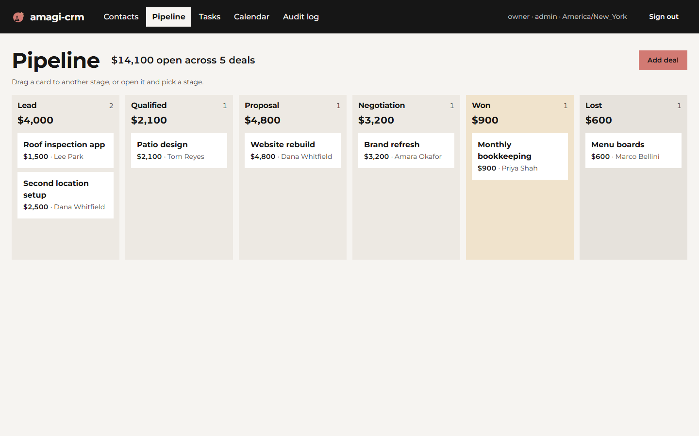
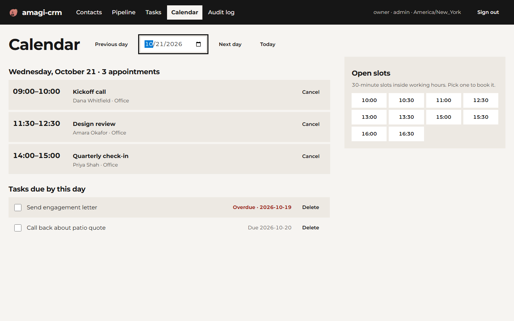

# amagi-crm

A CRM for small firms that you host yourself: contacts, a Kanban deal pipeline, tasks and
appointment booking. You get a web UI, a REST API and a CLI. Client details are encrypted in the
database, and every change, read and export goes into an audit log that shows if anyone edits it
later. It runs on SQLite with one command, or on PostgreSQL with Docker Compose.

## Demo


```
$ amagi-crm import contacts.csv
Ignored columns: Source, Date Added
Imported 8 contacts from contacts.csv: 1 duplicate emails skipped, 1 invalid rows.
  row 11: not a valid email address: 'not-an-email'

$ amagi-crm deals board
Lead (1, $12,000)
  #1    Roof repair contract                $12,000
Qualified (0, $0)
Proposal (0, $0)
Negotiation (0, $0)
Won (1, $4,500)
  #2    Practice website                     $4,500
Lost (0, $0)

$ amagi-crm book "2030-11-04 10:15" --title "Second meeting"
amagi-crm: that time overlaps another booked appointment

$ amagi-crm audit verify
Audit chain OK: 15 entries, head d8f326924ee9...
```

(The audit head hash is shortened here. The tool prints all 64 characters.)





## Install

```
pipx install amagi-crm
```

It isn't on PyPI yet. Until it is, install from a clone of this repo:

```
pipx install .
```

You need Python 3.10 or newer. To run on your own PostgreSQL server outside Docker, add the driver
with `pipx inject amagi-crm "psycopg[binary]"` and set `DATABASE_URL=postgresql+psycopg://...` in
`.env`.

## Quick start (SQLite, one machine)

```
$ amagi-crm init --timezone America/New_York --hours "mon-fri 09:00-17:00"
Wrote .env with new encryption keys. Back it up somewhere safe.
Created admin user 'admin'. API token (shown once, store it now):
  acrm_JLf8AqWp...
Next: amagi-crm serve, then open http://127.0.0.1:8000

$ amagi-crm serve
```

Open http://127.0.0.1:8000 and sign in with that token. The API docs are at `/docs`.

`init` writes a `.env` file with your encryption keys. Treat that file like a password. If you lose
the keys, the encrypted fields can't be recovered. Back up `.env` and the database to different
places, because anyone holding both can read everything.

## Docker Compose (PostgreSQL)

```
cp .env.example .env
docker build -t amagi-crm . && docker run --rm amagi-crm keygen --postgres >> .env
docker compose up -d
docker compose exec app amagi-crm user add admin --role admin
```

`keygen` prints fresh keys and a database password and writes nothing itself. The `>>` appends them
to `.env`. The app listens on 127.0.0.1:8000 only (change the port with `AMAGI_CRM_PORT`). Put a TLS
reverse proxy such as Caddy or nginx in front of it before anyone connects over a network.

## Usage

Every command reads `.env` in the current folder, or the file you name with `--env-file` before the
command. Without the keys it exits with an error instead of writing plaintext.

### Import contacts

Import from another CRM's CSV export. Common headers map on their own (First Name,
E-mail Address, Mobile Phone, Business Name, Tags and so on). A dry run makes the same checks and
writes nothing:

```
$ amagi-crm import contacts.csv --dry-run
Ignored columns: Source, Date Added
Dry run, nothing written. Would import 8 contacts from contacts.csv: 1 duplicate emails skipped, 1 invalid rows.
  row 11: not a valid email address: 'not-an-email'
```

### Find contacts

Search by name, company, email or phone with `--search`, or filter by tag:

```
$ amagi-crm contacts --tag client
id  name          company          email              phone     tags
--  ------------  ---------------  -----------------  --------  ---------------
3   Amara Okafor  Okafor Design    amara@example.org  555-0142  client
5   Priya Shah    Shah Accounting  priya@example.net  555-0144  client,referral
```

### Work the pipeline

The stages are Lead, Qualified, Proposal, Negotiation, Won and Lost. Moving a
deal to Won or Lost records the close date.

```
$ amagi-crm deals add "Roof repair contract" --amount 12000 --contact-email lee@example.com
Added deal #1: Roof repair contract ($12,000)

$ amagi-crm deals add "Practice website" --amount 4500 --contact-email dana.whitfield@example.com
Added deal #2: Practice website ($4,500)

$ amagi-crm deals move 2 Won
Moved deal #2 'Practice website' to Won.

$ amagi-crm deals summary
Pipeline, 2026-10-19 to 2026-10-25
  New deals     2     $16,500
  Won           1      $4,500
  Lost          0          $0
  Open now      1     $12,000
    Lead          1     $12,000
    Qualified     0          $0
    Proposal      0          $0
    Negotiation   0          $0
```

`deals summary --json` gives the same report for a script or a weekly email.

### Tasks, bookings and the agenda

Bookings never overlap. The agenda lists the open slots inside
working hours.

```
$ amagi-crm tasks add "Send the signed proposal" --due tomorrow --contact-email lee@example.com
Added task #1: Send the signed proposal (due 2026-10-21)

$ amagi-crm book "2030-11-04 10:00" --title "Site walk-through" --contact-email lee@example.com
Booked #1: Site walk-through, 2030-11-04 10:00 to 10:30

$ amagi-crm agenda --date 2030-11-04
Monday 04 November 2030 (America/New_York)
  10:00-10:30  Site walk-through
Tasks due:
  #1 Send the signed proposal (overdue, due 2026-10-21)
Open slots: 09:00, 09:30, 10:30, 11:00, 11:30, 12:00, 12:30, 13:00, 13:30, 14:00, 14:30, 15:00, 15:30, 16:00, 16:30
```

### Users and calendar feeds

Roles are `admin`, `member` (read and write) and `readonly`. Each user
can get a private `.ics` link to subscribe to from Google Calendar or Outlook. The feed shows only
"Busy" unless you set `AMAGI_CRM_FEED_DETAILS=1`.

```
amagi-crm user add sam --role member
amagi-crm user feed-token sam --base-url https://crm.example.com
```

### Public booking page

Set `AMAGI_CRM_PUBLIC_BOOKING=1` and `/book` lets visitors pick an open
slot without signing in. Each IP address gets 5 booking attempts per hour.

Run `amagi-crm --help` for the rest: `contacts add`, `tasks done`, `export`, `user list`,
`user revoke`.

## Encryption and the audit log

### What's encrypted

The app encrypts these fields with Fernet (AES-128-CBC plus HMAC-SHA256) before anything reaches
the database: contact names, emails, phones, companies, tags and notes, the titles and notes of
deals, tasks and appointments, and appointment locations. Amounts, stages, dates and IDs
stay in plaintext so the board can total and sort them. Emails also get a keyed HMAC blind index,
so duplicates are caught without storing the address in the clear. Open the database in any SQLite
or PostgreSQL client and a contact's `email` column holds a Fernet token starting `gAAAAA`, next to
a 64-character hex `email_index`.

### Key rotation

Generate a new key with `amagi-crm keygen --key-only` and put it first in
`AMAGI_CRM_ENCRYPTION_KEYS`, keeping the old key after it. Then run `amagi-crm rotate-keys`. Once a
second run reports 0 rows, back up and remove the old key.

### Audit log

Every create, update, delete, move, read of a single record, import and export is
logged with who, when, what and the field names (never the values). Each entry's HMAC covers its own
contents and the hash of the entry before it. `amagi-crm audit verify` exits 1 and names the first bad entry if a row was
edited, deleted or reordered:

```
$ amagi-crm audit verify
Audit chain BROKEN at entry 3: row content does not match its hash (row edited)
```

`amagi-crm audit tail -n 20` shows recent entries. The chain can't reveal entries cut off the
end, so copy the head hash somewhere off the server now and then and compare it later.

## Limits

- One firm, one time zone, one shared calendar. No per-user calendars and no recurring appointments.
- Search decrypts rows in the app, since encrypted columns can't be searched in SQL. That's fine for
  tens of thousands of contacts, not millions.
- No email or SMS sending, and no two-way calendar sync (the `.ics` feed is read-only).
- Encryption protects the database and its backups. It doesn't help if an attacker can read `.env`
  or the memory of the running server.
- This isn't a compliance certification. It gives you the parts (encryption at rest, an audit
  trail, roles), and your firm decides whether a deployment meets its rules.

## Star this if it saved you time

If amagi-crm replaced a CRM bill you were paying every month, a star helps other small firms find it.

## Other AmagiLabs projects

- [amagilabs on GitHub](https://github.com/amagilabs): small open-source tools for small
  businesses and law firms from AmagiLabs (Amagisolutionsgroup, Inc.).
- [legal-review-skills](https://github.com/amagilabs/legal-review-skills): Claude Code skills for a
  first-pass review of NDAs, MSAs and leases.

## License

MIT. See [LICENSE](LICENSE). Copyright (c) 2026 AmagiLabs (Amagisolutionsgroup, Inc.).
